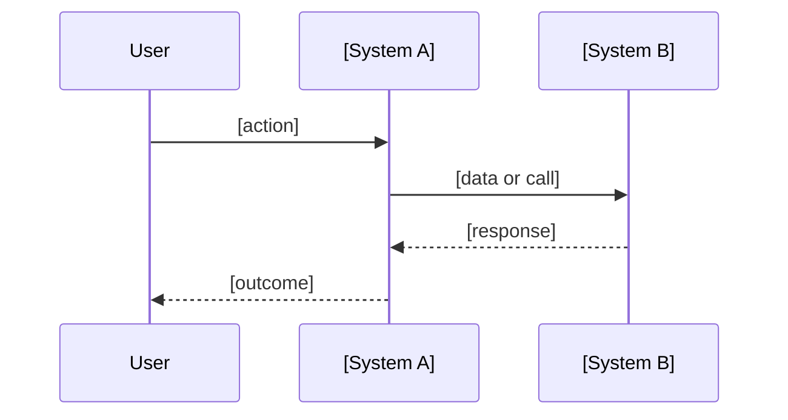
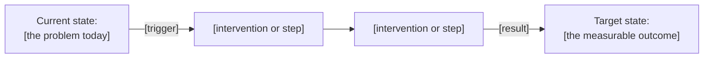
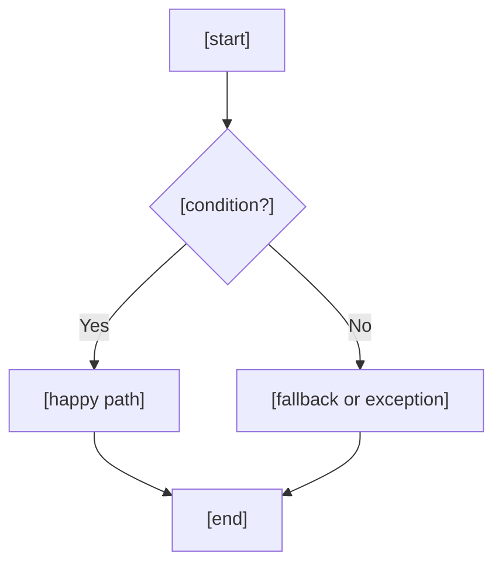
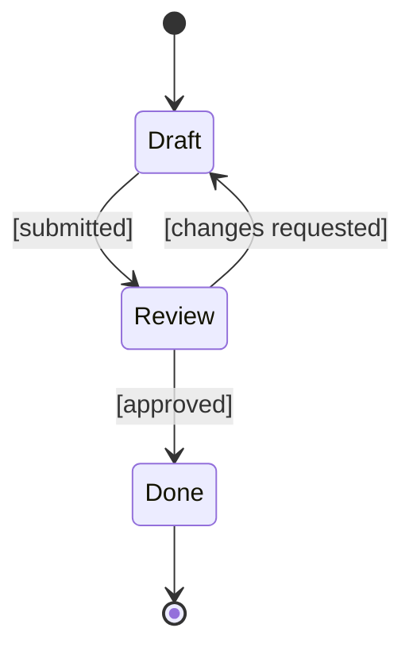

# Mermaid Templates

Skeletons to adapt, not fill in. Replace every bracketed placeholder with names from the context.

---

## System Interaction — `sequenceDiagram`

What talks to what. Solid arrows are calls, dashed arrows are responses.



---

## Journey — `flowchart LR`

From where things are to where they should be. One node per state or intervention.



---

## Decisions and Exceptions — `flowchart TD`



---

## Lifecycle — `stateDiagram-v2`



---

## Syntax Rules

Check each before presenting a diagram — these are the common render failures.

- Quote any node label or edge label containing `( ) [ ] { } : ; , #` or a keyword: `A["Label (x)"]`.
- In `sequenceDiagram`, give multi-word or symbol-bearing participants an alias:
  `participant API as Payments API`. Never use `end` as a bare participant or node id.
- Node ids are single tokens (`Step1`, `orderSvc`); the readable text goes in the label.
- Line breaks inside a label use `<br/>`, not `\n`.
- Mark unconfirmed elements in the label text: `C["Notify customer [unconfirmed]"]`.
- The saved `.mmd` holds raw Mermaid only: no ```` ``` ```` fence.
